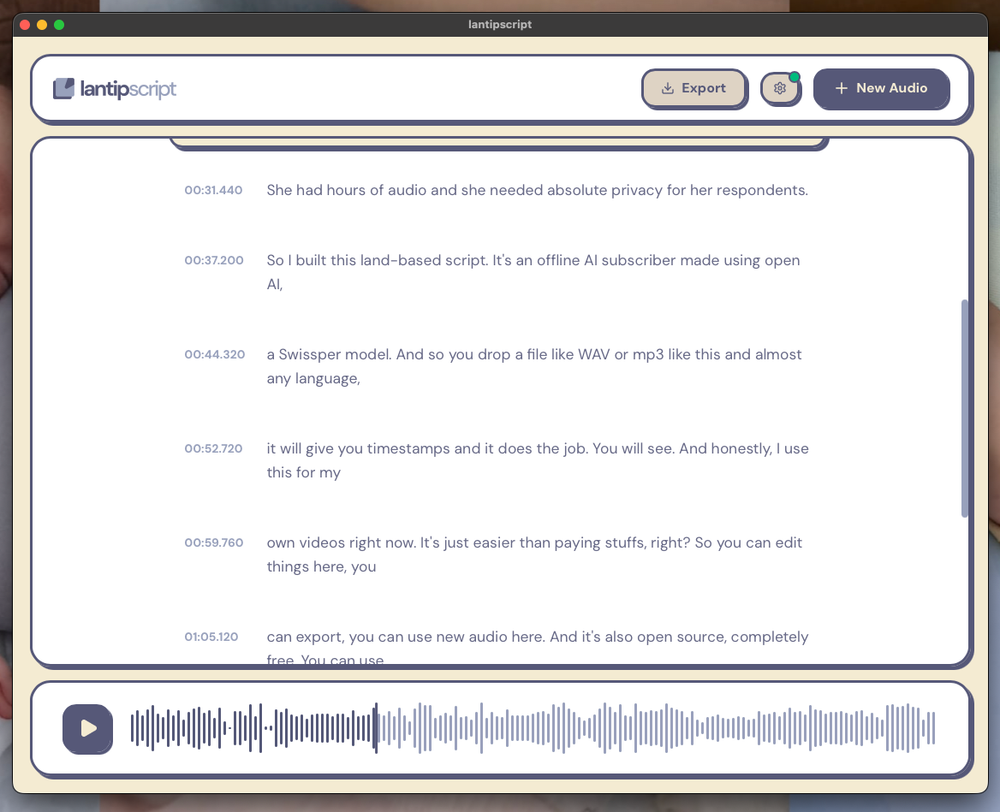

  

<em>A transcriber that stays on your computer.</em>

LantipScript turns interview recordings into text, entirely on your own machine — no cloud, no account, no upload. You drop in a recording, the text appears beside it, and the conversation stays where it happened.

  

## What it doesn't do

Most apps that call themselves local still ask you to download a model before the first run. LantipScript doesn't. The listening model comes inside the app — chosen once, when you pick your build — and after that it never needs the internet, and offers no way to use it.

- No model screen, no download button, no account, no telemetry.
- Your audio, the transcript, and every edit stay on your hard drive.
- Works on a plane, in a basement office, anywhere the internet doesn't reach.

## Download

The home of the app is **[lantip.space/lantipscript](https://lantip.space/lantipscript)**. Direct downloads for v1.0.0 are below, and every file also lives on the [Releases](../../releases) page.

All builds are the same app, and all of them are fully offline. The only difference is the listening model they carry, and how much of your download it costs.

| Build | Choose it when | Speed | macOS (Apple silicon) | Windows (64-bit) |
| --- | --- | --- | --- | --- |
| **Full** | your computer is recent — an Apple silicon Mac, or a PC with a working GPU | best accuracy | [.dmg — 564 MB](https://github.com/sawungrana/lantipscript/releases/download/v1.0.0/lantipscript_full_mac_1.0.0_aarch64.dmg) | [.exe — 572 MB](https://github.com/sawungrana/lantipscript/releases/download/v1.0.0/lantipscript_full_windows_1.0.0_x64.exe) |
| **Lite** | your computer is older, or you're not sure | fast, close to Full | [.dmg — 214 MB](https://github.com/sawungrana/lantipscript/releases/download/v1.0.0/lantipscript_lite_mac_1.0.0_aarch64.dmg) | [.exe — 237 MB](https://github.com/sawungrana/lantipscript/releases/download/v1.0.0/lantipscript_lite_windows_1.0.0_x64.exe) |
| **Express** | the download needs to be small, or you want a rough first pass | fastest, least accurate | [.dmg — 58 MB](https://github.com/sawungrana/lantipscript/releases/download/v1.0.0/lantipscript_express_mac_1.0.0_aarch64.dmg) | [.exe — 85 MB](https://github.com/sawungrana/lantipscript/releases/download/v1.0.0/lantipscript_express_windows_1.0.0_x64.exe) |

**Which file is mine?**

- **macOS** — Apple silicon only ([M1 or newer](https://support.apple.com/en-us/116943); "About This Mac" will say "Apple M…"). Download the `.dmg`, open it, and drag LantipScript into Applications.
- **Windows** — 64-bit Windows 10 or 11. Download the `.exe` and run it.

If you'd rather not decide between Full, Lite, and Express: Full if the machine is new, Lite if it isn't. The gear icon shows which build is running and whether it got GPU acceleration. Express carries the smallest model, so it mishears more, especially in Bahasa Indonesia — treat it as a draft, and let Lite or Full do the real transcript.

## Using it

1. Drag an audio or video file onto the window — mp3, wav, m4a, mp4, mov.
2. Watch the progress bar. Nothing leaves the machine while it works.
3. Click any line to jump the recording to that moment; edit the text directly.
4. Export a plain `.txt` with timestamps, tidy for NVivo or Atlas.ti.

English and Bahasa Indonesia are detected automatically.

## Building it yourself

You can, and the whole thing keeps running offline when you do.

1. `git clone https://github.com/sawungrana/lantipscript.git` and `npm install`
2. **The brains:** download one Whisper model (`ggml-large-v3-turbo-q5_0.bin` recommended; `docs/MODELS.md` has the SKU models, URLs, and checksums) and put it in `src-tauri/resources/`. The app resolves Full → Lite → Express, so keep one model per local build.
3. **The ears:** download the static FFmpeg binary for your OS, rename it (`ffmpeg-aarch64-apple-darwin`), and put it in `src-tauri/bin/`.
4. Run with GPU acceleration: `npm run tauri dev -- --features metal` (macOS) or `npm run tauri dev -- --features vulkan` (Windows/Linux). Without a feature flag it still runs, CPU-only.
5. Smoke-test without the UI, with any audio file:
   `cd src-tauri && cargo run --release --example transcribe --features metal -- <path-to-audio.mp3>`

The UI is React with Tailwind and a soft neo-brutalist hand; the shell is Tauri v2.

## Notes

LantipScript is named after my son, Lantip. It was made for my own interview recordings, and it tries to stay as calm and as private as research deserves.
